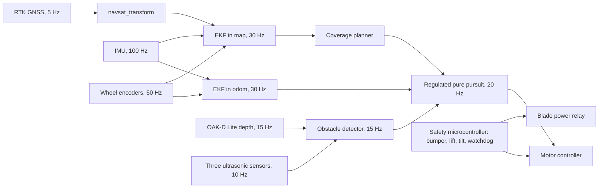

# System Design Exercise: A Complete Worked Example

This is what a full-credit report looks like, written for a scenario that is not on the list: a robotic lawn mower for one house. Every number below comes from the instructions notebook as delivered, so you can run each tool and see the same output. Where a real report would show the figure a tool draws, this example quotes the numbers instead.

Read it once to see the depth expected, then design your own system. Reusing the structure is expected. Reusing the reasoning is not, because your scenario has different requirements.

## Summary

A robotic mower must mow a 500 m² suburban lawn without a buried boundary wire, never leave the lawn by more than 0.10 m, and stop short of children and pets. The design fuses RTK GNSS, wheel odometry, and a gyro in two EKFs, and detects obstacles with a depth camera backed by three ultrasonic sensors and a bumper wired to a hardware blade interlock. In open sky the boundary error budget closes at 0.073 m (95 percent) against 0.10 m. The side passage with no GNSS ends at 0.108 m against 0.25 m. An aged 7.5 Ah pack gives 87 minutes per charge. Under the tree, RTK float fails the budget, so boundary passes there dead-reckon for at most 8 m from the last fixed solution. The largest open risk is path tracking on wet grass, an assumption until it is tested.

## Design loops

| # | What failed | What changed | Where |
|---|---|---|---|
| 1 | An 18 V, 5 Ah pack gave 58 min on an aged pack, under the 60 min of R7, and drew 2.78C at peak, over its 2C limit | A 7.5 Ah pack: 87 min aged, 1.85C peak | Section 5.4 |
| 2 | The boundary error budget failed under the tree: RTK float gives 0.787 m at 95 percent against 0.10 m | Boundary control ignores float solutions, and passes under the canopy run at most 8 m past the last fixed solution (R11) | Section 4.4 |
| 3 | The failure analysis found that the camera can be blinded by low sun or water, at severity 9, and the first design had no second obstacle sensor | Three ultrasonic sensors, a different physics, and a bumper and lift switch that cut blade power in hardware | Section 6.1 |

## The client and the given requirements

The client is a company that wants to sell a mower that needs no boundary wire. One customer's yard is the reference design. Student scenarios have four given requirements; this client gave seven.

| ID | Given requirement |
|---|---|
| G1 | Mow the whole 500 m² lawn, at least 95 percent of its area, each session |
| G2 | No part of the mower more than 0.10 m outside the lawn boundary, 95 percent of the time |
| G3 | No buried boundary wire |
| G4 | Stop at least 0.15 m short of a child, a pet, or any object 0.3 m tall or more |
| G5 | Work through the 15 m long, 1.2 m wide side passage beside the house |
| G6 | Sensing and computing parts cost at most $1,000 per mower |
| G7 | The blade stops within 1 s when the mower is lifted or tilted beyond 30° |

## 1. Problem Definition

### 1.1 Operational concept

**Users and stakeholders.** The owner sets up the boundary once and wants a mown lawn, undamaged flower beds, and no fuss. Two children and a dog use the yard. They did not ask for a robot, and it must never hurt them. The neighbors care about noise and about the mower staying out of their yard. A service technician replaces blades and batteries.

**The yard.** A 300 m² back lawn and a 200 m² front lawn, joined by a 15 m long, 1.2 m wide side passage between the house wall and a fence. A large maple shades the west edge of the back lawn, where its canopy covers 12 m of the boundary and about 60 m² of lawn. Flower beds border both lawns. The dock is on the back patio.

**One normal mission.** The mower leaves the dock, stands still for 30 s to estimate its gyro bias, and waits for an RTK fixed solution. It mows the back lawn in parallel passes at 0.5 m/s, then follows the boundary once. Near its energy reserve it docks and charges. It then crosses the side passage with the blade off, at 0.3 m/s, and mows the front lawn the same way. With a 0.22 m cut at 0.5 m/s and 70 percent efficiency for turns and overlap, it covers 0.077 m²/s, so the whole lawn takes about 108 min of mowing, in two charges. At the end it sends a coverage map to the owner's phone.

**Operating envelope.** Daylight only, the mowing season, 5 to 35 °C, dry or wet grass, slopes up to 10°.

**Off-nominal events.**

| Event | What the system should do |
|---|---|
| RTK drops to float under the maple | Keep mowing the interior; boundary passes under the canopy only within R11 |
| The home Wi-Fi drops, so the NTRIP corrections stop | Stop boundary passes once the correction age passes 10 s, mow the interior, and dock if it lasts |
| A child or the dog walks into the path | Stop at least 0.15 m short, and resume once the path has been clear for 5 s |
| Someone lifts the mower | Blade stops within 1 s, in hardware |
| Rain | Return to the dock |
| The mower gets stuck in the passage | Stop with the blade off, and alert the owner |

**Scope.** Not covered: the blade and deck design, the phone app, theft protection, and the charger electronics in the dock.

### 1.2 Requirements

| ID | Requirement | Value | Type | Source or rationale | Verification |
|---|---|---|---|---|---|
| R1 | The mower's body stays inside the boundary | at most 0.10 m outside, 95 percent of boundary passes | Given | G2 | T1 boundary laps |
| R2 | Coverage | at least 95 percent of the lawn area per session | Given | G1 | T2 coverage from logged poses |
| R3 | No buried wire | none | Given | G3 | Inspection |
| R4 | Cross-track localization error on boundary passes | at most 0.035 m, 1σ | Derived from R1 | Error budget, Section 4.4: 0.0354 m allowed | Analysis, then T1 |
| R5 | Stop short of a 0.3 m tall object | at least 0.15 m short | Given | G4 | T3 foam block trials |
| R6 | Detect a 0.3 m tall object across a 0.75 m wide path | at 0.6 m or more, over 64° or more | Derived from R5 | Tool 1: 0.425 m to stop from 0.5 m/s on wet grass with a 350 ms reaction time, plus the 0.15 m margin, is 0.575 m. Tool 2: 64.0° | T3 |
| R7 | Mowing time per charge, aged pack, 15 percent reserve kept | at least 60 min | Derived from R2 | 108 min of mowing in two charges, with margin | T4 runtime test |
| R8 | Side passage without GNSS | no wall contact: cross-track error at most 0.25 m, 95 percent | Given (G5), value derived | 0.325 m of clearance on each side, less tracking error | T5 passage mock-up |
| R9 | Blade stop on a lift, or a tilt beyond 30° | within 1 s | Given | G7 | T6 lift and tilt trials |
| R10 | Sensing and computing cost per mower | at most $1,000 | Given | G6 | Analysis, Section 3.6 |
| R11 | Boundary passes under the canopy | at most 8 m past the last RTK fixed solution | Derived from R4 | Tool 5 at 0.3 m/s: 8.4 m | T7 covered-antenna pass |
| R12 | Interval between RTK fixes in open sky | at most 10 s | Derived from R4 | Tool 5 sweep: 10 s meets, 20 s fails | Analysis, then T1 |

### 1.3 Assumptions and scope

- The owner maps the boundary once by walking it with the mower's RTK receiver on a pole, and walks it again whenever the beds change.
- RTK corrections come over the home Wi-Fi by NTRIP, as in Lab 2. A base station on the roof is the fallback if the service proves unreliable.
- Path tracking error on grass is 0.03 m (1σ). This is assumed, not measured, and Section 6.3 makes it the first test.
- Lateral wheel slip adds noise of 0.005 m per √s, also assumed.
- The analysis uses VN-100 datasheet values for the gyro. A student with Lab 3 results gets their own numbers in Tool 4 automatically.

## 2. System Architecture

### 2.1 Functional architecture and pipeline

Figure 1, the pipeline. GitHub draws this Mermaid block as a diagram; in the report it is redrawn in draw.io.



The safety microcontroller is drawn apart on purpose. It reads the bumper, the lift switch, and the tilt, and it opens the blade relay without asking the Raspberry Pi.

### 2.2 Physical architecture

| Part | What runs on it | How it connects |
|---|---|---|
| Raspberry Pi 5, 4 GB | Drivers, both EKFs, planner, controller, supervisor, logging | USB 3 to the camera, USB to the receiver and the Pico, UART to the IMU, UART to the motor controller |
| OAK-D Lite processor | Stereo depth, on the camera itself | USB 3 |
| Raspberry Pi Pico 2 | Reads the three ultrasonic sensors | UART to each sensor, USB serial to the Pi |
| Safety microcontroller | Bumper, lift, tilt, the motor watchdog, the blade relay | Hard-wired. No software on the Pi can override it |
| Motor controller | Drive and blade motors | Stops the motors if no command arrives for 0.5 s |

The 18 V pack feeds the motors directly. A DC-DC converter feeds the electronics, with the receiver on its own regulator so that the blade's start current cannot reset it (failure analysis, Section 6). RTK corrections arrive over the home Wi-Fi.

### 2.3 Operating modes

| Mode | Entered when | Behavior | Left when |
|---|---|---|---|
| Normal | RTK fixed, all sensors healthy, 95 percent position bound under 0.07 m | Mow at 0.5 m/s | |
| Degraded position | The bound passes 0.07 m, or RTK float | Interior passes only, 0.3 m/s; boundary passes only within R11 | The bound stays under 0.07 m for 5 s |
| Degraded perception | Valid depth pixels under 50 percent of the path region for 0.5 s | 0.2 m/s on the ultrasonic sensors | Valid pixels over 80 percent for 2 s |
| Passage | Planned entry into the side passage | Blade off, 0.3 m/s, dead reckoning on a centered path | RTK fixed again on the far side |
| Pause | Correction age over 10 s, rain, or energy at the reserve | Blade off, return to the dock | The cause clears, or charging ends |
| Safe stop | Bumper, lift, tilt over 30°, or the 0.5 s watchdog | Blade power cut in hardware, motors stopped | The owner resets it from the phone after the cause is cleared |

The 0.07 m threshold is R4 as a 95 percent bound: 1.96 × 0.035 m.

### 2.4 ROS 2 nodes and topics

| Node | Package | Publishes | Rate |
|---|---|---|---|
| RTK driver | Lab 2 `rtk_driver`, plus a small adapter | `/gnss/fix` as `sensor_msgs/NavSatFix`, with the covariance set from the GGA quality field | 5 Hz |
| IMU driver | Lab 3 `vn_driver`, with register 7 set to 100 | `/imu` | 100 Hz |
| Motor bridge | own | `/wheel/odometry` | 50 Hz |
| Camera driver | depthai-ros from Luxonis; Jazzy release confirmed with `apt search` before relying on it | `/oak/stereo/depth` | 15 Hz |
| Ultrasonic node | own, reading the Pico over USB serial | `/ultrasonic/left`, `/center`, `/right` as `sensor_msgs/Range` | 10 Hz |
| ekf_odom, ekf_map, navsat_transform | robot_localization | `/odometry/filtered`, `/odometry/gps` | 30 Hz |
| Obstacle detector | own | `/obstacles` | 15 Hz |
| Coverage planner | own, using the Fields2Cover library | the mowing path | on each start |
| Controller | Nav2 regulated pure pursuit | `/cmd_vel` | 20 Hz |
| Supervisor | own | `/mode`, `/diagnostics` | 10 Hz |

## 3. Sensor Selection

### 3.1 Sensing needs

| Need | From | Quantity | Value |
|---|---|---|---|
| See a 0.3 m tall object in the path | R5, Tool 1 | detection range | 0.6 m or more |
| Cover the full width of the path | R5, Tool 2 | horizontal field of view | 64° or more at 0.6 m |
| Absolute position on boundary passes | R4 | 1σ error | 0.035 m or less |
| Heading through 15 m with no GNSS | R8, Tools 4 and 5 | gyro N and B | VN-100 datasheet values or better |
| Lift and tilt | R9 | detection time | well under 1 s |

### 3.2 Trade study: absolute position

| Candidate | Accuracy | Must-meet: R4, 0.035 m | Must-meet: R3, no wire | Result |
|---|---|---|---|---|
| RTK GNSS, SparkFun GPS-RTK2 with u-blox ZED-F9P | 0.010 m horizontal with RTK (datasheet) | passes | passes | Kept |
| RTK GNSS, SparkFun RTK mosaic-X5 | 6 mm + 0.5 ppm horizontal with RTK (datasheet) | passes | passes | Kept |
| UWB anchors around the yard | decimeter level in typical use | fails | passes | Screened out |
| Boundary wire | follows the wire | | fails | Screened out |
| Camera following the grass edge | no absolute position | fails | passes | Screened out, kept in mind as a canopy backup |

The screen did most of the work here, which is common. Both receivers meet R4 by a wide margin, so the deciding criterion is cost, under R10: the ZED-F9P board lists at $259.95 against $1,249.95 for the mosaic-X5. The product uses the ZED-F9P. The prototype uses a course-owned mosaic-X5, which costs nothing. The runner-up is the mosaic-X5, and it wins if the ZED-F9P loses its fixed solution too often near the maple, which test T7 measures.

### 3.3 Trade study: obstacle detection (Tool 3)

**Criteria and weights**, with their reasons written before any scoring:

| Criterion | Weight | Threshold and goal | Why |
|---|---|---|---|
| Detection range for a 0.3 m object | 0.15 | must reach 0.6 m (R6); goal 4 m | More range lets the mower slow early, but 0.6 m already meets R5 |
| Minimum range | 0, screen only | must be 0.5 m or less | Anything nearer is the bumper's job |
| Horizontal field of view | 0.10 | must reach 64° (Tool 2); goal 180° | The corners near the mower matter |
| Price | 0.15 | must be $300 or less; goal $20 | R10 is tight |
| Sees low objects (judgment) | 0.20 | 0 to 1 | Toys, hoses, and a lying dog sit below a 2D lidar's plane |
| Works outdoors (judgment) | 0.15 | 0 to 1 | Sun, rain, and grass clippings |
| Tells grass from an obstacle (judgment) | 0.20 | 0 to 1 | False stops on tall grass would make the mower useless |
| ROS 2 driver (judgment) | 0.05 | 0 to 1 | A driver saves time, but a serial driver is a Lab 1 exercise |

**Datasheet values.** Prices are list prices at the time this example was written.

| Candidate | Range for a 0.3 m object | Minimum range | Field of view | Price | Source |
|---|---|---|---|---|---|
| OAK-D Lite depth camera | 3.0 m, where depth error stays under 2 percent | 0.40 m | 73° horizontal (stereo pair) | $269 | Luxonis datasheet and shop |
| RPLIDAR C1 2D lidar | 6.0 m on a 10 percent reflective target | 0.05 m | 360° | about $80 | Slamtec specifications, Waveshare price |
| Three A02YYUW ultrasonic sensors | 2.0 m assumed for a soft, round target; 4.5 m is quoted for a flat one | 0.03 m | three 60° cones fanned over about 150° | 3 × $15.90 | DFRobot datasheet and price |
| Bumper switch only | contact only | 0 m | 180° | about $10, estimated | |

**Judgment scores**, one sentence each:

| Candidate | Low objects | Outdoors | Grass or obstacle | ROS 2 driver |
|---|---|---|---|---|
| OAK-D Lite | 1.0: it sees the whole height window from 0 to 0.40 m at 0.6 m (Tool 2) | 0.6: passive stereo works in sunlight, but the lens needs a hood and protection from water and clippings | 1.0: color and depth together separate a dog from grass | 1.0: Luxonis publishes depthai-ros |
| RPLIDAR C1 | 0.2: it sees only its own scan plane | 0.4: an indoor product whose plane hits tall grass on every slope | 0.3: in one plane, a grass tuft and a leg look alike | 1.0: Slamtec publishes sllidar_ros2 |
| Ultrasonic array | 0.7: its wide cone catches low objects but cannot say how tall they are | 0.9: IP67, and it works in any light | 0.1: a tuft of tall grass echoes like a toy | 0.7: a simple serial driver, like Lab 1 |

**Result** (Tool 3 output):

```
Screened out: Bumper switch only, fails range_m

Candidate                       score   wins
Depth camera, OAK-D Lite        0.670    85%
Ultrasonic array, 3 x A02YYUW   0.601    10%
2D lidar, RPLIDAR C1            0.578     4%
Winner: Depth camera, OAK-D Lite, in 85% of 5000 weight perturbations: a clear choice
```

The camera is the primary obstacle sensor. The runner-up is the ultrasonic array; it would win if test T3 showed more than one false stop on grass per session from the camera. The bumper failed the screen as a primary sensor, but it stays in the design as the last layer. Loop 3 later added the ultrasonic array as well, not as a competitor but as a second sensor with different physics.

### 3.4 Final suite and placement

| Sensor | Where | Coverage (Tool 2) |
|---|---|---|
| OAK-D Lite | Front, 0.25 m high, tilted 15° down | Ground visible from 0.26 m. At 0.6 m it sees heights from 0.00 to 0.40 m. It needs 64.0° at 0.6 m and has 73°, but at its 0.4 m minimum depth it would need 86.3°, so the front corners within about 0.6 m are a blind zone |
| Three ultrasonic sensors | Front left and right, angled 45° out, and front center, 0.12 m high | Cover the camera's corner blind zones and anything under 0.4 m |
| Bumper and lift switch | All around the shell | Contact and lift, wired to the safety microcontroller |
| RTK antenna | On a 0.30 m mast above `base_link` | Clear sky over the body |
| IMU | At the center of the chassis | Tilt for R9, rate for heading |

Tool 2 also checks the camera against its datasheet. With a 432 px focal length, a 0.075 m baseline, and 0.2 px of disparity noise, the stereo formula gives 5.5 cm of depth error at 3 m, which is 1.8 percent, consistent with the datasheet's under 2 percent. At 3 m, a 5 cm post gets 8.4 camera pixels but only 1.3 lidar points, which is another reason the lidar lost.

### 3.5 Prototype parts list for the final project

The prototype is a TurtleBot 4 on a paved courtyard with a taped boundary and no blade. It tests the riskiest assumptions, path tracking and boundary keeping, for almost no money. Tool 9 output:

| Part | Model | Qty | Unit price | Owned | Mass (kg) | Power (W) | Source |
|---|---|---|---|---|---|---|---|
| Platform | TurtleBot 4 | 1 | n/a | yes | 0 | 0 | course |
| RTK GNSS receiver and antenna | SparkFun RTK mosaic-X5 kit | 1 | $1,249.95 | yes | 0.350 | 2.50 | course, Lab 2; mass and power estimated |
| IMU | VectorNav VN-100 Rugged | 1 | n/a | yes | 0.015 | 0.20 | course, Lab 3; datasheet |
| Ultrasonic sensor | DFRobot A02YYUW (SEN0311) | 3 | $15.90 | no | 0.020 | 0.04 | dfrobot.com; mass estimated |
| Ultrasonic interface | Raspberry Pi Pico 2 | 1 | $5.00 | no | 0.004 | 0.10 | Raspberry Pi resellers |
| Power for the receiver | USB-C power bank, 10,000 mAh | 1 | $20.00 | no | 0.200 | 0 | estimate |
| Sensor mounts | 3D-printed PLA | 1 | $5.00 | no | 0.080 | 0 | estimate, filament only |
| Boundary marking | painter tape, 2 rolls | 1 | $10.00 | no | 0 | 0 | estimate |

Out of pocket: $87.70, against a $150 prototype budget. Added mass 0.71 kg, far under the TurtleBot 4's 9 kg payload. The receiver runs from its own power bank, so it does not shorten the TurtleBot's runtime. The TurtleBot uses its own OAK-D camera. Its top speed is about 0.3 m/s, so prototype tests run at the passage speed, and Tool 1 scales the stopping results to 0.5 m/s.

### 3.6 Product cost, for R10

| Part | Price | Source |
|---|---|---|
| SparkFun GPS-RTK2 board, ZED-F9P | $259.95 | SparkFun list price |
| Antenna, cables, enclosure, and mounts | $150.00 | allowance, to be quoted |
| OAK-D Lite | $269.00 | Luxonis list price |
| Three A02YYUW ultrasonic sensors | $47.70 | DFRobot list price |
| Raspberry Pi 5, 4 GB | $110.00 | list price after the memory-driven increases; it has changed several times, so check |
| Raspberry Pi Pico 2 | $5.00 | list price |
| IMU | $50.00 | allowance: any IMU, once Tools 4 and 5 are rerun with its datasheet values and still pass |
| Safety microcontroller, switches, and relay | $40.00 | allowance |
| **Total** | **$931.65** | R10 allows $1,000: met, with $68 to spare |

## 4. Localization, Mapping & Navigation

### 4.1 Methods

| Function | Choice | Alternative considered | Why it lost |
|---|---|---|---|
| Localization | RTK GNSS, wheel odometry, and gyro in two EKFs from robot_localization: one in `odom` without GNSS, one in `map` with it | Visual-inertial odometry from the OAK-D | Grass is low in texture and repetitive, and VIO still drifts without an absolute fix |
| Mapping | A boundary polygon from an RTK teach-in walk, plus a canopy zone where the walk did not have a fixed solution | A 2D occupancy grid from SLAM | A lawn has no walls for scan matching, and the polygon is all the planner needs |
| Navigation | Parallel-pass coverage with the Fields2Cover library, Nav2 regulated pure pursuit, and a behavior tree for the mission | Random bounce mowing, as wire-guided mowers do | Coverage takes far longer, and R1 needs planned boundary passes |

### 4.2 Estimator design

| Item | EKF in `odom` | EKF in `map` |
|---|---|---|
| States | x, y, yaw, forward speed, yaw rate | the same |
| Process model | planar differential drive, constant velocity | the same |
| Measurements | wheel odometry at 50 Hz, IMU yaw rate at 100 Hz | the same, plus GNSS position at 5 Hz through navsat_transform |
| GNSS noise | not used | 0.02 m when the GGA quality field is 4 (fixed); 0.4 m when it is 5 (float), for interior passes only; any other value is rejected |
| Outlier rejection | innovation test at 99 percent | the same; three GNSS rejections in a row stop boundary passes |
| Start | 30 s standing still at the dock for the gyro bias | the first fixed solution sets the map origin at the dock |

Standing still for 30 s gives a bias estimate of about N/√30 = 2.3 deg/h, already better than the datasheet's 10 deg/h. Tools 4 and 5 still start from the pessimistic 10 deg/h.

### 4.3 Drift and outage analysis

**The gyro** (Tool 4, VN-100 datasheet): N = 6.11e-05 rad/√s, which is 0.210 deg/√h, and B = 4.85e-05 rad/s, which is 10.0 deg/h.

**The side passage, first estimate** (Tool 4). Assuming a heading error of 0.3° at the entrance, the cross-track error after the 50 s crossing is 0.090 m (1σ), so 0.177 m at 95 percent, against the 0.25 m limit of R8. The starting heading term dominates the plot. Along the track, a 2 percent odometry scale error adds 0.301 m (1σ) over 15 m. That only shifts where the mower thinks the passage ends, and RTK returns on the far side.

**The side passage, with the filter** (Tool 5). After 200 s of driving on 5 Hz RTK fixes, the filter enters the passage with 6.9 mm of cross-track error, 0.13° of heading error, and the gyro bias learned down to 4.0 deg/h, all 1σ. The heading is better than Tool 4's assumed 0.3°, because RTK fixes reveal the heading while the mower moves. At the far end the error is 0.055 m (1σ), or 0.108 m at 95 percent. R8 is met with 0.14 m to spare.

**The IMU alone** (Tool 4). With no wheels and no GNSS, the VN-100's 95 percent bound passes 1 m after 3.5 s, mostly from its 0.5° tilt error. The wheels are not optional.

**How far apart fixes may be** (Tool 5, open lawn at 0.5 m/s, against R4's 0.069 m at 95 percent):

| Fix interval | Peak error, 95 percent | Result |
|---|---|---|
| 0.2 s | 0.014 m | meets |
| 1 s | 0.022 m | meets |
| 2 s | 0.028 m | meets |
| 5 s | 0.039 m | meets |
| 10 s | 0.054 m | meets |
| 20 s | 0.080 m | fails |
| 30 s | 0.107 m | fails |

This gives derived requirement R12: no more than 10 s between fixes in open sky. The receiver delivers 5 Hz, so R12 means a dropout of up to 10 s needs no change of mode.

### 4.4 Error budget for boundary passes

Working backwards first (Tool 6): with the other four entries fixed, localization may contribute at most 0.0354 m (1σ). That is R4.

**Open sky** (Tool 6 output):

| Contributor | 1σ (m) | Share | Source |
|---|---|---|---|
| Localization, RTK fixed | 0.007 | 3% | Tool 5, 5 Hz fixes |
| Boundary map, RTK teach-in walk | 0.020 | 29% | Lab 2 fixed precision, pole held by hand |
| Path tracking, pure pursuit on grass | 0.030 | 64% | assumption, to test on the prototype |
| Antenna lever arm, tilt-corrected | 0.005 | 2% | 1° tilt error × 0.30 m antenna height |
| Time stamps, 10 ms at 0.5 m/s | 0.005 | 2% | GNSS time, with the latency compensated |
| **Total** | **0.037** | | **0.073 m at 95 percent, against 0.100 m: meets, with 0.027 m to spare** |

The sensors are not the problem: path tracking is 64 percent of the variance. Halving it to 0.015 m would bring the bound down to about 0.053 m. That is why the first prototype test measures tracking error.

On precision and accuracy: Lab 2 measured a fixed precision of about 0.02 m. In open sky, RTK fixed solutions are accurate to about the same level, because the corrections remove the errors the receiver shares with its base. Near the house wall, multipath can bias them, which is the wrong-fix failure in Section 6. So the map entry is labeled accuracy, assumed, and T1 tests it.

**Under the maple** (Tool 6 output): with RTK float at 0.40 m, the total is 0.402 m (1σ), or 0.787 m at 95 percent. It fails by 0.687 m.

**Loop 2, the design change.** Boundary control under the canopy ignores float solutions and dead-reckons from the last fixed solution. Tool 5 at 0.3 m/s shows that dead reckoning meets R4 for 28.1 s after the last fix, which is 8.4 m. R11 rounds that down to 8 m. The canopy covers 12 m of boundary, so the planner enters it from both ends, and each pass runs at most 6 m past its last fixed solution. Interior passes under the canopy still use float solutions, so their coverage there may drop to about 70 percent. The zone is 12 percent of the lawn, so overall coverage stays near 96 percent, inside R2. Test T2 checks it.

### 4.5 Mapping, planning, control, and docking

**Map.** A boundary polygon from the owner's teach-in walk, with the receiver on a pole, stored in the `map` frame with its origin at the dock. The walk also records the canopy zone, wherever the GGA quality was not 4. The owner walks the boundary again whenever the beds change.

**Planning.** Parallel passes 0.20 m apart for the 0.22 m cut, then one boundary pass per lawn, and a fixed route through the side passage.

**Control.** Nav2 regulated pure pursuit at 20 Hz. Its tracking error on grass, 0.03 m (1σ), is the assumption with the largest effect on R1.

**Docking.** A fiducial marker on the dock, seen by the camera, guides the last 1 m to within the ±2 cm the charging contacts need. Charge current confirms the dock.

## 5. System Integration

### 5.1 Frames and calibration

```
map
└── odom
    └── base_link
        ├── gnss_antenna    (0.00, 0.00, 0.30) m, tape measure
        ├── imu_link        (0.00, 0.00, 0.08) m, CAD
        ├── oak_link        (0.25, 0.00, 0.25) m, pitched 15° down, CAD then checked with a target
        ├── us_left         (0.24, 0.15, 0.12) m, yawed 45° left
        ├── us_center       (0.27, 0.00, 0.12) m
        └── us_right        (0.24, -0.15, 0.12) m, yawed 45° right
```

| What | How | How often | Acceptance check |
|---|---|---|---|
| Gyro bias | 30 s standing still at the dock | every start | changed less than B, 10 deg/h, since the last start |
| Wheel odometry scale | drive a 10 m line measured with RTK | weekly, and after a wheel change | error under 0.5 percent on dry grass |
| Antenna lever arm | tape measure | once | ±5 mm |
| Camera extrinsics | checkerboard at 1 m | after any knock | reprojection error under 0.5 px |
| Boundary map | a second teach-in walk | after any change to the beds | the two walks agree within 0.05 m |

### 5.2 Time

The Pi's clock follows the receiver's GNSS time through chrony and the receiver's PPS output. GNSS solutions are stamped with their own GNSS time, not their arrival time; the arrival-time stamp was worth 80 ms, or 0.04 m at 0.5 m/s, in the failure analysis. The serial latency of the IMU was measured once against GNSS time and is compensated. The residual 10 ms is an error budget entry: 0.005 m at 0.5 m/s.

### 5.3 Data rates and compute

**Data** (Tool 7). Logging everything, with depth at 15 Hz, takes 9.472 MB/s: 68.2 GB in a 2 h session, more than a 64 GB card holds. Logging a 1 Hz throttled copy of the depth instead brings the log to 0.870 MB/s, or 6.3 GB per session. The full 9.2 MB/s depth stream still crosses USB 3, which has plenty of room for it. The Wi-Fi link to the phone carries 0.02 Mbit/s.

**Compute** (estimates, to be measured with `top` on the prototype):

| Node | Runs on | Expected load |
|---|---|---|
| Stereo depth | the OAK-D Lite's own processor | none on the Pi |
| Obstacle detector on depth | Pi 5 | about 25 percent of one core |
| Both EKFs and navsat_transform | Pi 5 | under 10 percent of one core |
| Drivers | Pi 5 | about 10 percent of one core |
| Planner, controller, supervisor | Pi 5 | about 20 percent of one core |
| Logging | Pi 5 | about 10 percent of one core |
| **Total** | | **under one of the Pi's four cores, far more than 30 percent headroom** |

### 5.4 Power and runtime (Tool 8)

The loads: blade 30 W average and 150 W peak; drive motors 16 W and 80 W; Raspberry Pi 5, 6 W and 12 W; OAK-D Lite, 3 W and 5 W; receiver 0.4 W; IMU 0.2 W; ultrasonic sensors 0.1 W; safety microcontroller 0.3 W. With the electronics divided by a 0.90 converter efficiency, the total is 57.1 W average and 250.3 W peak.

**Loop 1.**

| Pack | New | Aged | Aged and cold | Peak current | R7: 60 min aged |
|---|---|---|---|---|---|
| 18 V, 5 Ah, 90 Wh | 72 min | 58 min | 49 min | 13.9 A, 2.78C, over the 2C limit | fails |
| 18 V, 7.5 Ah, 135 Wh | 108 min | 87 min | 74 min | 13.9 A, 1.85C | meets |

The 5 Ah pack works when new and fails once it has aged, which is exactly the trap in Lecture 06. It also fails on peak current. The 7.5 Ah pack meets R7 with 27 min to spare, and its peak current is within the limit, though only by 0.15C. The pack's continuous rating is an assumption to confirm on its datasheet.

### 5.5 Verification plan

| Test | Requirements | What | Pass criterion | Equipment | In the final project? |
|---|---|---|---|---|---|
| T1 boundary laps | R1, R4, R12 | 20 laps of a taped boundary on pavement, with chalk at the body edge drawing the path, measured every 1 m | 95th percentile of the overshoot at most 0.10 m | TurtleBot 4, RTK receiver, tape measure | Yes |
| T2 coverage map | R2 | coverage computed from logged poses and the cut width, over a full session | at least 95 percent | rosbag2 logs, a script | Yes, on the courtyard |
| T3 foam block trials | R5, R6 | 20 approaches to a 0.3 m foam block at different offsets and angles | stops at least 0.15 m short every time; first detection at 0.6 m or more | TurtleBot 4 at 0.3 m/s, OAK-D, ultrasonic sensors | Yes |
| T4 runtime | R7 | a full charge with a dummy blade load | at least 60 min on a pack aged to 80 percent | mower prototype, power meter | No, product phase |
| T5 passage mock-up | R8 | walls 1.0 m apart, which keeps the real 0.325 m clearance for the TurtleBot's width; antenna covered with a foil-lined box for 15 m | no wall contact in 10 runs; final error compared with Tool 5 | TurtleBot 4, RTK receiver | Yes |
| T6 lift and tilt | R9 | 20 lifts and 20 tilts with the blade running | stops within 1 s every time | mower prototype, tachometer | No, product phase |
| T7 canopy pass | R11 | drive 8 m past the last fixed solution with the antenna covered | 95 percent cross-track error within 0.069 m | TurtleBot 4, RTK receiver | Yes |

**Traceability** (Tool 10). The first check found two problems: R11 had no test, and the magnetometer served no requirement. Test T7 now covers R11. The magnetometer is removed, which the failure analysis also called for. R12, added after the fix interval sweep, is verified by analysis and then by T1. The check now reports no problems.

## 6. Failure Analysis

### 6.1 Failure modes, ranked (Tool 11)

```
Failure mode                                       S  O  D  RPN  after
Magnetometer heading bent by the motors            5  8  7  280      5
GNSS stamped on arrival, 80 ms late                4  8  7  224     24
Camera blinded by low sun or a wet lens            9  4  6  216     54   severity 9 or 10
Boundary map wrong after the teach-in walk         6  5  6  180     54
Pet approaches from the side, in the blind zone    9  3  6  162     36   severity 9 or 10
Wheel slip on wet grass                            5  6  5  150     60
RTK drops to float under the tree                  6  7  3  126     36
Main computer hangs, last command repeats          8  3  5  120     24
Wrong RTK fix near the house wall                  7  2  8  112     42
Voltage sag at blade start resets the receiver     6  3  4   72     12
Mower lifted with the blade spinning              10  3  2   60     10   severity 9 or 10
Heavy rain                                         6  5  2   60     30
NTRIP corrections lost, home Wi-Fi down            7  4  2   56     24
Stuck in the side passage longer than planned      6  3  3   54     18
Misses the dock contacts                           4  4  3   48      8
```

Two rows came from the AI review and are marked as such in the report: GNSS stamped on arrival, and misses the dock contacts. See Appendix B.

The lift case shows why severity outranks RPN. Its RPN of 60 ties for eleventh of fifteen, yet it is the only row that can injure someone without warning. Ranking by RPN alone would have put it near the bottom.

**Loop 3.** The first design had the camera as its only obstacle sensor. The camera-blinded row, at severity 9, has no answer in such a design, because nothing else would notice the dog. The fix adds the three ultrasonic sensors, whose physics fails under different conditions than a camera's, and wires the bumper and lift switch to the safety microcontroller, which cuts blade power without the Pi.

### 6.2 Detection and recovery

| Failure | Detection and threshold | Response | Mode | Leaves when |
|---|---|---|---|---|
| Magnetometer heading bent (280) | nothing reliable | removed from the design | | |
| GNSS stamped on arrival (224) | RTK track lagging odometry by more than 20 ms in turns | GNSS time stamps; the measured latency compensated | a design fix | |
| Camera blinded (216, severity 9) | valid depth pixels under 50 percent of the path region for 0.5 s | slow to 0.2 m/s on the ultrasonic sensors | Degraded perception | over 80 percent for 2 s |
| Boundary map wrong (180) | the two teach-in walks disagree by more than 0.05 m | the owner walks it again | before the first run | |
| Pet from the side (162, severity 9) | a side ultrasonic sensor under 0.3 m, or the bumper | stop; the bumper cuts blade power in hardware | Safe stop | the owner resets it |
| Wheel slip (150) | wheel speed and RTK speed differ by more than 20 percent | inflate the odometry noise, slow to 0.3 m/s | Degraded position | they agree again for 5 s |
| Mower lifted (60, severity 10) | lift switch, or tilt over 30° from the IMU | the blade relay opens in hardware within 1 s | Safe stop | the owner resets it |

### 6.3 Residual risk

- Path tracking on wet grass is assumed at 0.03 m and is 64 percent of the boundary budget. **The first prototype test is T1 on the courtyard, then on grass.**
- The camera and the ultrasonic sensors both degrade in heavy rain, so one event can take out both. The rain sensor sends the mower home, so it never mows in that condition.
- A small wrong RTK fix near the house can pass the innovation test. T1 includes passes along the house wall to measure it.
- The canopy zone grows with the maple, so the teach-in walk must be repeated each season.

## References

1. Luxonis, OAK-D Lite product page and hardware documentation.
2. Slamtec, RPLIDAR C1 specifications, via Waveshare.
3. DFRobot, A02YYUW waterproof ultrasonic sensor (SEN0311).
4. SparkFun, GPS-RTK2 Board (ZED-F9P) and RTK mosaic-X5 product pages.
5. VectorNav, VN-100 product brief.
6. Open Robotics, REP 103 and REP 105.
7. Course materials: Lab 2 (RTK precision), Lab 3 (gyro noise), and Lecture 06 (power budget).

## Appendix A: Tools used

| Tool | Version | What for | Where in the report |
|---|---|---|---|
| System Design Exercise notebook, Tools 1 to 11 | course repository | every budget and analysis | Sections 1 to 6 |
| Python, NumPy, Matplotlib | Python 3.12 with the Ubuntu 24.04 packages | running the notebook | Appendix C |
| draw.io desktop | the installed version | the pipeline and placement figures | Figures 1 and 2 |
| ROS 2 Jazzy: `ros2 topic bw`, `rqt_graph`, tf2_tools | Jazzy | topic sizes and the node graph on the TurtleBot 4 | Section 5 |
| Lab 2 and Lab 3 results | | RTK precision; gyro noise, here from the datasheet | Section 4 |
| Datasheets, listed in the references | | trade studies and budgets | Sections 3 to 5 |
| A general-purpose AI chat assistant | named in Appendix B | see Appendix B | Sections 3 and 6 |

Record the exact version numbers in your own table.

## Appendix B: AI use log

| # | Tool and version | Part | What I asked, in short | What I used | How I verified it | What I rejected, and why |
|---|---|---|---|---|---|---|
| 1 | general-purpose chat assistant (product and model recorded) | 3 | The field of view of the OAK-D Lite | Nothing | It gave 81°, which the Luxonis datasheet lists as the color camera's diagonal field of view. The stereo pair is 73° horizontal and 58° vertical, which Tool 2 uses | The 81° figure |
| 2 | the same | 6 | After my Pass 1 list of 13 failure modes: ask me questions about modes I might have missed, without rewriting the list | Two of its questions led to the GNSS time stamp row and the dock contacts row, both marked as AI-suggested | I estimated the time stamp effect myself: 80 ms at 0.5 m/s is 0.04 m, more than R4 allows | A question about GPS jamming by neighbors, which is not credible for a backyard |
| 3 | the same | 5 | Why a NumPy cell in my coverage script raised a broadcasting error | The explanation; I fixed the code myself | The script reproduces the area of a test square to 0.1 percent | Nothing |

*I used AI tools only as listed in this log. The design decisions, numbers, and text in this report are my own, and I can explain each of them.* Signed by the student.

## Appendix C: Calculations

`analysis/sde_analysis.ipynb` in the repository, run with the values above, and exported as `sde_analysis.html`.

## The five slides

| Slide | Title | What is on it | Time |
|---|---|---|---|
| 1 | A wire-free mower that never leaves a 500 m² lawn | Name and scenario in the header; a sketch of the yard with the passage and the maple; R1, R5, R7, and R8 with their numbers; success means T1 and T3 pass | 0:50 |
| 2 | RTK, wheels, and a gyro feed two EKFs; the blade stop needs no software | Figure 1 with rates, the safety microcontroller drawn apart | 1:00 |
| 3 | A depth camera finds pets in grass; ultrasonics and a bumper back it up | The Tool 3 bar chart (0.670 against 0.601 and 0.578, winning 85 percent of perturbations); the Tool 2 side view; the prototype at $87.70 out of pocket and 0.71 kg; the product at $931.65 of $1,000 | 1:10 |
| 4 | The boundary budget closes in the open, and the planner handles the tree | The open-sky budget (0.073 m of 0.10 m); the passage plot (0.108 m of 0.25 m); R11 at 8 m; 87 min on an aged pack | 1:10 |
| 5 | Three failures we designed for, and the test we run first | The lift interlock, the blinded camera with the ultrasonic backup, and the watchdog; the open risk, path tracking at 64 percent of the budget; first test T1 on the courtyard; one line of tools: the notebook, draw.io, ROS 2 Jazzy, datasheets, and an AI assistant as logged | 0:50 |

Questions to prepare for: Why not the mosaic-X5 in the product? What if the camera and the ultrasonic sensors both miss the dog? How do you know the tracking error is 0.03 m? What happens if the maple grows? Why is 30 s enough for the gyro bias?
