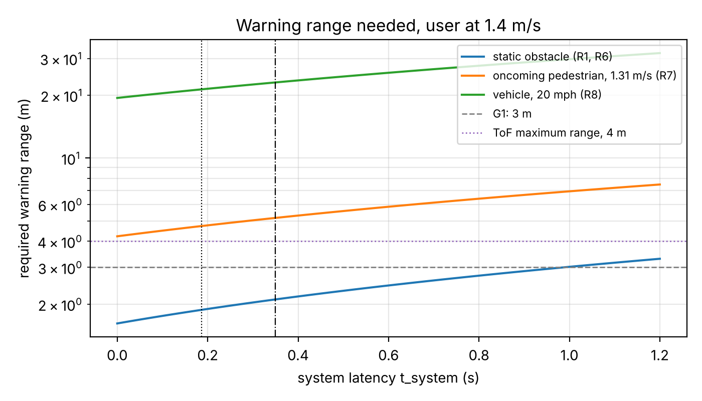
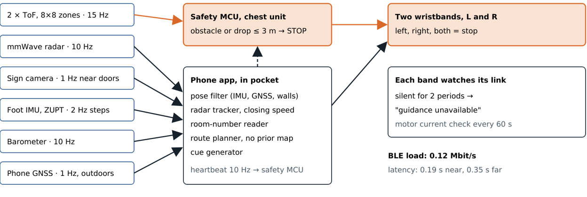
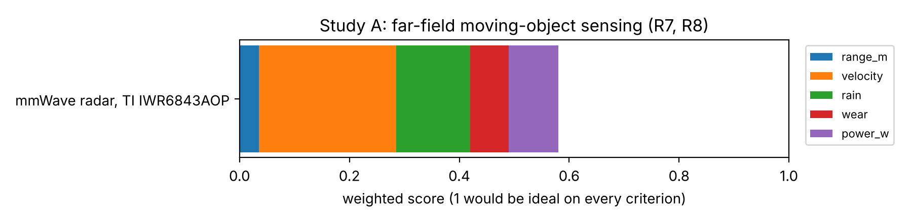
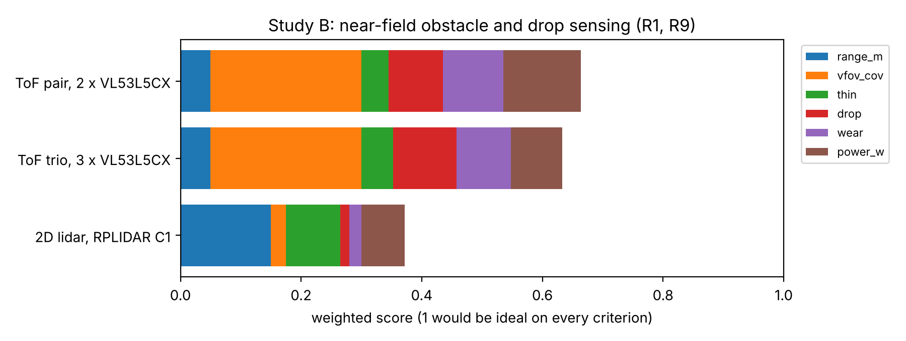
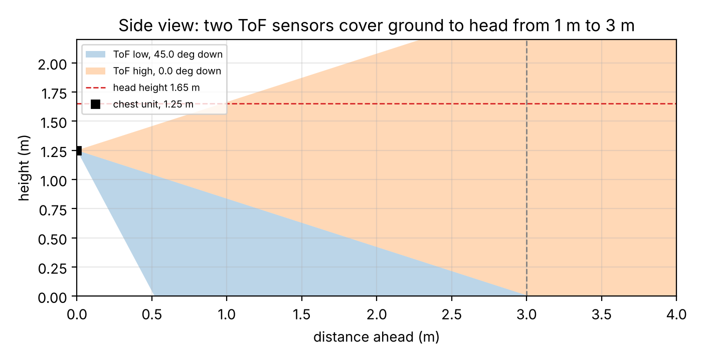
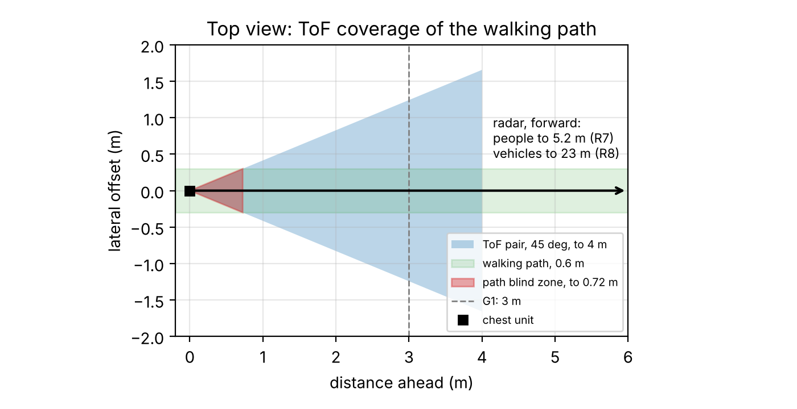
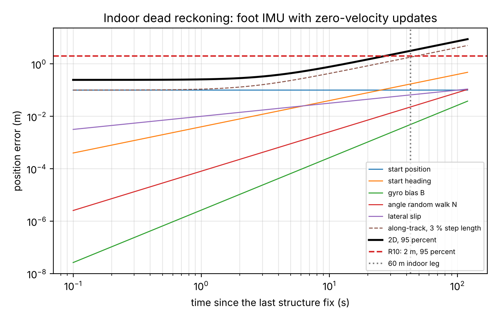
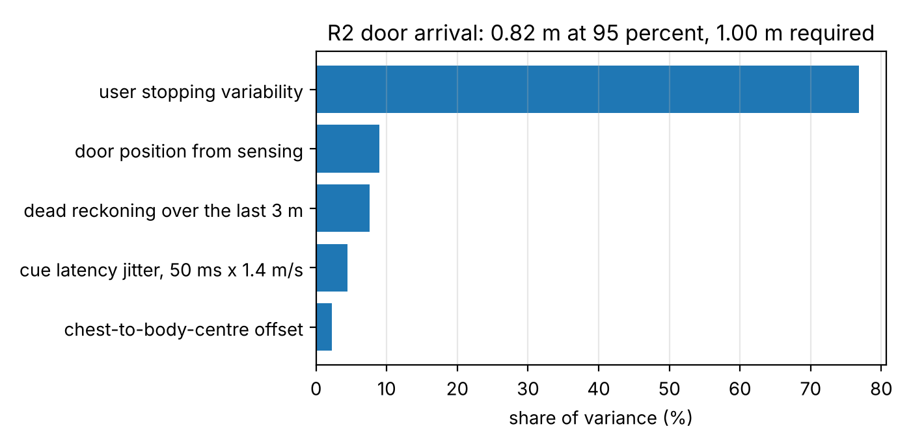
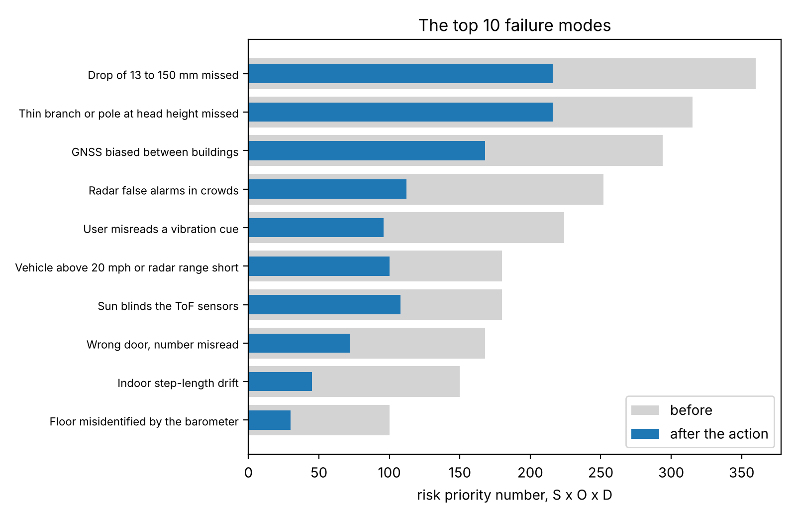

# System Design Exercise: Wearable Navigation Aid for a Blind Pedestrian

**Name:** Zhiqi Zhang
**Scenario:** S9, Wearable Navigation Aid for a Blind Pedestrian
**Repository:** https://github.com/ZhiQ1/EECE5554

## Summary

A blind pedestrian with no cane must walk from a bus stop to a room inside a building, warned of obstacles from the ground to head height and guided by vibration, with no phone in hand. The design puts two 8×8 time-of-flight sensors, a 60 GHz radar, a sign camera, and a safety microcontroller on a chest unit; a foot IMU does step-based dead reckoning; a phone in a pocket runs estimation and guidance; two wristbands vibrate left, right, or both for stop. The door-arrival budget closes at 0.82 m (95 percent) against 1 m. The worn mass is 292 g against 300 g, and runtime is 13.4 h on an aged pack at 2.8 °C, but only after the radar is duty-cycled. Moving obstacles need 5.2 m (people) and 23 m (vehicles), far beyond the given 3 m. The biggest open risk is small drops and thin branches that 8×8 ToF zones cannot resolve at 3 m.

## Design loops

| # | What failed | What changed | Where in the report |
|---|---|---|---|
| 1 | The human stopping model (steps to stop × walking step length) gave 1.29 to 1.89 m, about twice the 0.669 m measured in E8, and double-counted the reaction | Use E8's measured stopping distance from the cue directly: 1.113 m (mean + 2 SD) × (1.4/1.22)² = 1.466 m | 1.3, A7 |
| 2 | G1's 3 m is not enough for moving obstacles: an oncoming person needs 5.17 m and a vehicle 23.0 m with the far-field latency | Moving obstacles became their own sensing need (R7, R8), met by a radar; 3 m stays the near-field requirement | 1.3, 3.2 |
| 3 | R9 (warn of a 13 mm drop at 3 m) asks the ToF sensors to resolve a 3.4 cm range change inside a 0.29 m wide zone | R9 revised to drops of 150 mm or more at 3 m (the E12 ramp limit); 13 to 150 mm drops kept as residual risk | 3.4, 6.3 |
| 4 | Runtime with the radar at its datasheet duty (1.19 W) was 9.2 h on an aged pack at 2.8 °C, under 12 h | Radar duty-cycled to an estimated 0.6 W average: 13.4 h | 5.4 |
| 5 | A 60 m indoor walk on foot-IMU dead reckoning reached 3.15 m (95 percent), over the 2 m needed to find the right door | New R10: a structure fix (wall line, door frame, corner) at least every 35 m indoors | 4.3 |

## 1. Problem Definition

### 1.1 Operational concept

**Client.** An assistive technology company that will sell the device to blind pedestrians.

**Users and stakeholders.** The blind user wants to reach the right room alone, never be hurt, feel cues that are easy to tell apart, and wear something light that lasts the day. An orientation and mobility (O&M) instructor cares whether the device can be taught and trusted. Pedestrians, cyclists, and drivers must not be walked into. Building staff want nothing installed and nothing in the way. Whoever charges the device wants one charge a day.

**One normal mission.** A helper sets the destination on the phone before the trip, or the user picks a preset destination with the wristband buttons. The user steps off the bus and presses start. On the sidewalk the system tracks position from phone GNSS and foot-IMU steps, warns of obstacles, people, and vehicles, and gives turn cues. At the entrance GNSS fades; the system finds the door by sensing it. In the lobby and corridors it localizes against walls and door frames it senses, since nothing is installed and there is no prior map. In the elevator or on the stairs it tracks the floor. In the corridor it reads room numbers. When the target number is read and the user is within 1 m of that door, the system gives the arrival cue.

**Operating envelope.** Indoors and outdoors; daylight, dusk, streetlights, indoor light, and full darkness; dry and rain; 2.8 to 25.6 °C (Seattle December average low and August average high, E10); concrete sidewalks, curb ramps, indoor floors, and stairs; ordinary pedestrian traffic, not peak crowds.

| Off-nominal event | What the system should do |
|---|---|
| Obstacle or drop-off ahead within the warning range | Stop cue (both bands), then a direction cue once the way is clear |
| Vehicle approaching across the path | Stop cue at once |
| Position uncertainty too large to guide safely | "Position uncertain" pattern, guidance paused, obstacle warnings continue |
| Target door cannot be identified | "Not confirmed" pattern; the user asks a person nearby |
| Phone app crashes or Bluetooth link drops | Wristbands play "guidance unavailable"; the chest unit keeps the stop warning |
| Battery low | "Low battery" pattern once, at the Tool 8 reserve |

### 1.2 Requirements

| ID | Requirement | Value | Type | Source or rationale | Verification |
|---|---|---|---|---|---|
| R1 | Warn of an obstacle anywhere from the ground to head height ahead of the user | within 3 m, at 1.4 m/s; head height 1.65 m (A5) | Given | G1 | T1 obstacle approaches |
| R2 | Arrival position at the room door | within 1 m, 95 percent, horizontal radius (k = 2.45) | Given | G2 | T2 full missions |
| R3 | Total mass of all worn parts | under 300 g | Given | G3 | Inspection: weigh every worn part |
| R4 | Runtime of all worn parts on one charge | at least 12 h on an aged pack at 2.8 °C | Given | G3; E10 | Analysis (Tool 8), then T3 |
| R5 | The user does not look at or hold a phone | at no point in the mission | Given | G4 | Demonstration during T2 |
| R6 | Near-field latency, obstacle appearing to vibration | at most 0.989 s | Derived from R1 | (3 m − 1.466 m − 0.15 m) / 1.4 m/s | Analysis, then T4 |
| R7 | Warning range for an oncoming person who does not yield | at least 4.22 m + 2.71 m/s × t_system; 5.17 m at 0.35 s | Derived from R1, Q1 | Section 1.3 | Analysis, then T5 |
| R8 | Warning range for a vehicle crossing at a driveway | at least 19.41 m + 10.34 m/s × t_system; 23.0 m at 0.35 s | Derived from R1, A2 | Section 1.3, E11 | Analysis, then T6 |
| R9 | Warn of a downward change in level | 150 mm or more, at 3 m or more (revised from 13 mm, loop 3) | Derived from R1, A1 | E12; R6 budget at 3 m | T7 drop-off approaches |
| R10 | Interval between indoor structure fixes | at most 35 m of walking | Derived from R2 | Tool 4: 2D 95 percent error passes 2 m at 38.1 m | Analysis, then T8 |

### 1.3 Flow-down (Tool 1) and assumptions

**Stopping model.** The notebook's constant-deceleration model does not fit a person, so the human part is taken from E8, which measured unplanned stops from the cue (reaction included):

$$d_{detect} \ge v\,t_{system} + d_{human} + d_{margin}$$

with v = 1.4 m/s, d_human = 1.466 m (A7), and d_margin = 0.15 m. For a moving obstacle at speed v_o that does not yield, it keeps moving through the system latency and the user's stop time t_human = 1.99 s (E8, mean + 2 SD):

$$d_{detect} \ge (v + v_o)\,t_{system} + d_{human} + v_o\,t_{human} + d_{margin}$$

| Case | Speed of the obstacle | t_system | Required range |
|---|---|---|---|
| Static obstacle | 0 | 0.187 s (near field) | 1.88 m: G1's 3 m holds, with 1.12 m to spare |
| Oncoming person | 1.31 m/s (E9) | 0.35 s (far field) | 5.17 m |
| Vehicle at a driveway | 8.94 m/s, 20 mph (E11) | 0.35 s | 23.0 m |

*Figure 1. Required warning range against system latency (Tool 1).*

Near-field latency: ToF frame at 15 Hz 0.067 s, detection on the safety MCU 0.02 s, Bluetooth to the wristband 0.05 s, motor start 0.05 s. Far-field: radar frame 0.10 s, tracking on the phone 0.10 s, Bluetooth chest to phone to wristband 0.10 s, motor 0.05 s. All except the ToF frame are estimates that T4 measures.

**Assumptions and scope.**

| ID | Assumption | Evidence | Confidence |
|---|---|---|---|
| A1 | No white cane; the system covers ground to head | design choice | |
| A2 | Vehicles are in scope | design choice | |
| A3 | Nothing installed in the building; localize on sensed walls and doors | design choice | |
| A4 | No prior map; the door is found by reading its number | design choice | |
| A5 | One user, 1.65 m tall; chest unit at 1.25 m | design choice; chest height to measure | |
| A6 | Phone in a pocket; not counted in the 300 g (Q2) | design choice | |
| A7 | Stop from cue: 1.466 m at 1.4 m/s | E8 control group, mean + 2 SD, scaled by speed squared | Low |
| A8 | Phone GNSS accuracy 3 m (1σ) outdoors, pocket and buildings | Lab 1 standalone precision about 1.5 m, doubled for accuracy near buildings | Low |
| A9 | Foot-IMU step length error 3 percent; lateral noise 0.01 m/√s | to measure in T8 | Low |
| A10 | Radar detects a car at 23 m with the duty-cycled configuration | TI lists traffic monitoring as an application; range not on the datasheet | Low |

| A11 | Radar duty-cycled to 0.6 W average | estimate; the datasheet gives 1.19 W at 24 % duty | Low |
| A12 | The client is an assistive technology company | design choice | |

Open questions, settled by assumption:

| ID | Question | Decision |
|---|---|---|
| Q1 | Does G1's 3 m also apply to moving obstacles? | Yes; for moving obstacles 3 m is a minimum, and R7 and R8 set the larger ranges |
| Q2 | Does a phone carried in a pocket count toward the 300 g of G3? | No; it is the user's own device |
| Q4 | With no prior map, how is the destination door found? | By reading its room number on site; the destination is set before the trip on the phone, or chosen with the wristband buttons |

Out of scope: deciding when to cross a street (the user's O&M skills and accessible pedestrian signals; the system still warns of vehicles), snow, ice, and nights below 0 °C, doors that need a key card, voice interaction, emergency calls, more than one user, and charging hardware.

## 2. System Architecture

### 2.1 Functional architecture and pipeline

*Figure 2. End-to-end pipeline with data rates. Orange: the safety chain, which does not pass through the phone.*

Six sensors feed two processors. The near-field ToF pair goes straight to the safety microcontroller on the chest unit, which can command STOP on its own. Radar tracks, sign images, foot-IMU step vectors, barometer, and phone GNSS go to the phone app: pose filter, radar tracker, room-number reader, route planner, and cue generator. Both drive the two wristbands over Bluetooth Low Energy (BLE). Rates: ToF 15 Hz, radar 10 Hz, sign camera 1 Hz near doors, foot IMU 2 Hz step vectors, barometer 10 Hz, GNSS 1 Hz, heartbeat and cues 10 Hz.

### 2.2 Physical architecture

| Part | What runs on it | How it connects |
|---|---|---|
| Phone in a pocket (main computer) | GNSS, pose filter, radar tracker, room-number reader, planner, cue generator | BLE to every worn part |
| Chest unit | 2 ToF sensors, radar, sign camera, barometer; safety MCU reads the ToF sensors itself and watches the phone heartbeat | sensors wired to it; BLE to the phone and to each wristband; safety MCU on its own regulator |
| Two wristbands | MCU, vibration motor, own cell; link watchdog; motor current check at start and every 60 s | BLE |
| Foot IMU pod | step detection with zero-velocity updates, step vectors at 2 Hz | BLE |

### 2.3 Operating modes

| Mode | Entered when | Behavior | Left when |
|---|---|---|---|
| Normal | sensors healthy; 95 percent position bound under 1.2 m outdoors, 1 m within 5 m of the target door | guidance and all warnings | |
| Degraded position | bound over those thresholds | guidance paused, "position uncertain" pattern; warnings continue | bound under the threshold for 5 s |
| Degraded perception | ToF valid zones under 50 percent, or radar or camera data missing, for 2 sensor periods | "slow down" pattern; near-field warnings continue on the safety path | data valid again for 5 s |
| Safe fallback | no phone heartbeat for 2 periods, or no ToF data | safety MCU drives "guidance unavailable"; near-field STOP continues if ToF data is present, else a continuous stop pattern | the phone restarts and the user confirms with a button |
| Arrival unconfirmed | within 1 m of the expected door, number not matched | "not confirmed" pattern; the user asks a person nearby | number read and matched |
| Low battery | charge at the Tool 8 reserve | "low battery" pattern once | charging |

The 1.2 m outdoor threshold is the minimum clear width of a pedestrian access route (PROWAG, E12).

### 2.4 ROS 2 nodes and topics (final-project prototype)

The product is a phone app. The prototype runs ROS 2 Jazzy on a laptop standing in for the phone, as in the notebook's prototype path.

| Node | Package | Publishes | Rate |
|---|---|---|---|
| IMU driver | Lab 3 `vn_driver` | `/imu` (`sensor_msgs/Imu`) | 100 Hz |
| Step detector, ZUPT | own | `/steps` (`geometry_msgs/TwistWithCovarianceStamped`) | 2 Hz |
| Phone GNSS bridge | own | `/gnss/fix` (`sensor_msgs/NavSatFix`) | 1 Hz |
| ToF driver | own, over USB serial from the MCU | `/tof/low`, `/tof/high` (`sensor_msgs/PointCloud2`) | 15 Hz |
| Radar driver | own, TI point-cloud output over USB | `/radar/points` (`sensor_msgs/PointCloud2`) | 10 Hz |
| Pose filter | robot_localization 3.8.4 EKF, released for Jazzy (index.ros.org) | `/odometry/filtered` | 30 Hz |
| Tracker, door reader, planner, cue generator | own | `/tracks`, `/door`, `/cue` | 10 Hz |

## 3. Sensor Selection

### 3.1 Sensing needs

| Need | From | Quantity | Value |
|---|---|---|---|
| Static obstacles ground to head | R1, R6 | range; vertical coverage | 3 m or more; 0 to 1.65 m from 1 to 3 m |
| Path width | R1, Tool 2 | horizontal field of view | 11.4° at 3 m, 33.4° at 1 m (0.6 m path) |
| Oncoming people | R7 | range with closing speed | 5.17 m or more |
| Vehicles | R8 | range with closing speed | 23.0 m or more |
| Drops | R9 | range change seen at 3 m | 0.39 m for a 150 mm drop |
| All of the above in full darkness | 1.1 envelope | works with no light | yes |
| Door identity | Q4 | read a room number | at 1 to 2 m |
| Indoor dead reckoning | R2, R10 | step length and heading | foot IMU with ZUPT |

### 3.2 Trade study A: far-field moving-object sensing (R7, R8)

Weights, written before scoring: range 0.30 (R8 is the hardest number), closing speed 0.25 (R7 and R8 need it), power 0.20 (R4), rain 0.15 (Seattle), wearability 0.10. Must-meet: range of at least 23.0 m, works in darkness, power at most 2 W.

| Candidate | Range | Dark | Power | Source | Result |
|---|---|---|---|---|---|
| mmWave radar, TI IWR6843AOP | 23 m on a car assumed (A10) | yes | 1.19 W at 24 % duty | TI datasheet SWRS237C, Table 7-4 | Kept |
| 2D lidar, RPLIDAR C1 | 6.0 m | yes | | worked example | Out: range |
| ToF, VL53L5CX | 4 m | yes | | ST datasheet DS13754 | Out: range |
| Depth camera, OAK-D Lite | 3.0 m | no | | worked example | Out: range, dark, power |
| Ultrasonic, A02YYUW | 4.5 m flat target | yes | | worked example | Out: range |

The screen decided this study, as in the worked example: the radar is the only candidate left, and it measures closing speed directly.

*Figure 3. Trade study A, far-field moving-object sensing (Tool 3).*

 What would change the choice: T6 showing the radar cannot hold a car at 23 m.

### 3.3 Trade study B: near-field obstacle and drop sensing (R1, R9)

Weights: vertical coverage 0.25 (G1 is ground to head), power 0.20 (R4), range 0.15, thin objects 0.15, drops 0.15, wearability 0.10. Must-meet: 3 m range, works in darkness, power at most 1.5 W.

| Candidate | Range | Dark | Power | Score | Wins |
|---|---|---|---|---|---|
| 2 × VL53L5CX ToF | 4 m, 8×8 zones, 45° × 45°, 15 Hz (DS13754) | yes | 0.6 W (estimate) | 0.664 | 99.9 % |
| 3 × VL53L5CX ToF | same | yes | 0.9 W (estimate) | 0.633 | 0.1 % |
| 2D lidar, RPLIDAR C1 | 6 m, one plane | yes | 1.0 W (estimate) | 0.371 | 0 % |
| Depth camera, OAK-D Lite | 3 m | no | | screened out: dark, power | |
| 3 × A02YYUW ultrasonic | 2 m soft target | yes | | screened out: range | |

Judgment scores (0 to 1): the ToF pair covers the full height window (1.0, Tool 2) but puts only 0.17 zones on a 5 cm pole at 3 m (thin 0.3); the lidar sees one plane (coverage 0.1, drops 0.1). Winner: two ToF sensors; runner-up three. Switch if T1 shows head-height misses between 1 and 3 m.

*Figure 4. Trade study B, near-field obstacle and drop sensing (Tool 3).*

### 3.4 Final suite and placement

| Sensor | Where | Coverage and blind zones (Tool 2) |
|---|---|---|
| ToF low | chest, 1.25 m, 45° down | ground from 0.52 m; covers the ground to 3 m |
| ToF high | chest, 1.25 m, level | head height (1.65 m) visible from 0.97 m; with the low sensor, ground to 1.65 m from 1 to 3 m |
| Radar | chest, facing forward | people and vehicles to 23 m (A10) |
| Sign camera with IR LED | chest | room numbers at 1 to 2 m, near doors only |
| Foot IMU | shoe | steps, ZUPT |
| Barometer | chest unit | floor changes |

*Figure 5. Side view of the two ToF sensors on the chest at 1.25 m (Tool 2).*

A 150 mm drop at 3 m changes the range of the ground ray by 0.39 m; a 13 mm drop by only 3.4 cm, inside one 0.29 m zone, which is why R9 was revised (loop 3).

Seen from above (Figure 6), both ToF sensors face straight ahead with a 45° horizontal field of view: 0.83 m wide at 1 m and 2.49 m at 3 m, against the 11.4° and 33.4° a 0.6 m path needs. The whole path is inside the field of view from 0.72 m ahead; the triangle nearer than that is a blind zone at the path edges, already passed by the time anything in it could be reached. The radar faces forward along the same axis.

*Figure 6. Top view: ToF coverage of the 0.6 m walking path, its blind zone, and the radar axis (Tool 2).*

### 3.5 Prototype parts list

| Part | Model | Qty | Unit price | Owned | Mass (kg) | Power (W) | Source |
|---|---|---|---|---|---|---|---|
| Foot IMU | VectorNav VN-100 | 1 | n/a | yes | 0.015 | 0.20 | course, Lab 3 |
| Phone | the user's own | 1 | n/a | yes | | | own |
| Radar | TI IWR6843AOPEVM | 1 | $178.80 | no | 0.020 | 1.19 at the datasheet 24 % duty; 0.60 duty-cycled in the product (A11) | DigiKey, SWRS237C; mass estimated |
| ToF sensor | VL53L5CX breakout | 2 | $25.00 | no | 0.003 | 0.30 | estimate |
| MCU with BLE | nRF52840 board | 1 | $25.00 | no | 0.005 | 0.03 | estimate |
| Sign camera | small camera module with IR LED | 1 | $15.00 | no | 0.010 | 0.03 (0.30 at 10 % duty) | estimate |
| Barometer | barometer breakout | 1 | $10.00 | no | 0.001 | 0.001 | estimate |
| Battery cell | Samsung INR18650-35E | 3 | $5.00 | no | 0.050 | | Samsung SDI, 50 g max; price estimated |
| Wristband motors | LRA with driver | 2 | $10.00 | no | 0.010 | 0.10 | estimate |
| Straps and mounts | | 1 | $15.00 | no | 0.045 | | estimate |

Out of pocket $328.80 (Tool 9); the prototype adds 0.272 kg and 2.25 W at the datasheet radar power. Worn mass in the product: 292 g of 300 g (Section 5.5).

## 4. Localization, Mapping & Navigation

### 4.1 Methods

| Function | Choice | Alternative considered | Why it lost |
|---|---|---|---|
| Localization | EKF on the phone: foot-IMU steps with ZUPT, phone GNSS outdoors, wall and door-frame fixes indoors | Visual-inertial odometry on a chest camera | fails in full darkness, which is in scope |
| Mapping | No prior map (A4); a local map of walls and doors built on site, and room numbers read by the camera | A floor plan supplied by the building | A4: no prior map |
| Navigation | Route as a sequence of turns; local guidance by wristband cues; final approach on the read door | Turn-by-turn on a global map | needs the map A4 rules out |

### 4.2 Estimator design

| Item | Value |
|---|---|
| States | x, y, heading, gyro bias, floor |
| Process model | step vectors from the foot IMU with ZUPT |
| Measurements | phone GNSS 1 Hz, 3 m (A8), rejected unless its quality field shows a fix; wall-line heading and door-frame position from ToF, 15 Hz; barometric height 10 Hz |
| Frames | `map` (built on site), `odom`, `base_link` at the chest; `foot_imu`, `tof_low`, `tof_high`, `radar`, `camera` |
| Start | standstill at the bus stop for the gyro bias; heading from the first GNSS track |
| Outlier rejection | chi-square gate at 99 percent on every update; three GNSS rejections in a row → degraded position |

### 4.3 Drift and outage analysis

Tool 5, outdoors at 1.4 m/s with 3 m GNSS at 1 Hz, gives at the entrance: position 0.43 m, heading 0.16°, gyro bias 0.8 deg/h (1σ). Indoors, Tool 4 with the Lab 3 gyro values (z axis, N = 0.343 deg/√h, B = 0.8 deg/h) and a 3 percent step-length error: the along-track step-length term dominates, and the 2D 95 percent error passes 2 m after 27.2 s, or 38.1 m. A 60 m indoor leg reaches 3.15 m, so R10 requires a structure fix at least every 35 m (loop 5).

*Figure 7. Indoor dead reckoning with the foot IMU and zero-velocity updates, Lab 3 gyro values (Tool 4).*

### 4.4 Error budget for door arrival (R2)

| Contributor | 1σ (m) | Precision or accuracy | Source |
|---|---|---|---|
| User stopping variability | 0.292 | accuracy | E8 SD 0.222 m × (1.4/1.22)² |
| Door position from sensing | 0.100 | accuracy | assumption, T2 |
| Dead reckoning over the last 3 m | 0.092 | accuracy | Tool 4 |
| Cue latency jitter, 50 ms × 1.4 m/s | 0.070 | accuracy | assumption, T4 |
| Chest to body-centre offset | 0.050 | accuracy | assumption |
| **Total** | **0.334** | | **0.82 m at 95 percent (k = 2.45), against 1.00 m: meets, 0.18 m to spare** |

The user's stopping spread is 77 percent of the variance. Working backwards, it may grow to 0.375 m (1σ) before R2 fails.

*Figure 8. Error budget for arriving at the door, share of variance by contributor (Tool 6).*

### 4.5 Mapping, planning, control, and the final approach

The local map holds wall lines and door frames from the ToF sensors and the numbers read at each door; it is rebuilt each trip. The route is a list of turns and landmarks set before the trip. The final approach starts when the target number is read twice; the stop cue leads the door by the expected stopping distance, 1.47 m.

## 5. System Integration

### 5.1 Frames and calibration

`map → odom → base_link` (chest) → `tof_low` (pitch 45° down), `tof_high` (level), `radar`, `camera`; `foot_imu` is tracked through the step model. Static transforms from CAD of the chest unit, checked with a tape measure.

| What | How | How often | Acceptance check |
|---|---|---|---|
| Gyro bias | 5 s standstill | every start | change below 10 deg/h |
| Step length | walk a measured 20 m line | weekly | error under 3 percent (A9) |
| ToF pitch | wall at a known distance | after any knock | under 1° |
| Chest height | tape measure | when the strap changes | ±2 cm |

### 5.2 Time

The phone clock is the reference. The chest MCU and the wristbands stamp messages with their own clocks, synchronized from the phone heartbeat; the BLE latency is measured in T4 and compensated. A 50 ms error at 1.4 m/s is 0.07 m, an entry in the R2 budget.

### 5.3 Data rates and compute

| Topic | Size | Rate | Load |
|---|---|---|---|
| Radar tracks, 20 × 16 B | 320 B | 10 Hz | 25.6 kbit/s |
| ToF zones, 2 × 64 × 3 B | 384 B | 15 Hz | 46.1 kbit/s |
| Sign image crop, near doors | 5 kB | 1 Hz | 40.0 kbit/s |
| Foot-IMU step vectors, barometer, heartbeat, cues | | | 3.8 kbit/s |
| **Total over BLE** | | | **0.12 Mbit/s** |

Sending full 20 kB images would double it to 0.24 Mbit/s, so only the sign region is cropped on the chest unit. BLE application throughput is assumed at 0.5 Mbit/s, to measure. Radar processing runs on the radar's own DSP; the phone carries tracking, filtering, and number reading.

| Node | Runs on | Expected CPU load | Headroom (at least 30 %) | How we know |
|---|---|---|---|---|
| Radar signal processing | IWR6843AOP DSP | inside the radar's own frame budget | not on a shared processor | TI datasheet architecture |
| ToF read and STOP decision | safety MCU, nRF52840 | 20 % | 80 % | estimate; measure with the MCU cycle counter |
| BLE relay of radar, ToF, camera | safety MCU, nRF52840 | 15 % | (with the line above) 65 % | estimate |
| Pose filter (EKF) | phone, one core | 2 % | | estimate |
| Radar tracker | phone, one core | 5 % | | estimate |
| Room-number reader, 1 Hz near doors | phone, one core | 15 % | | estimate |
| Planner and cue generator | phone, one core | 3 % | | estimate |
| BLE stack | phone, one core | 3 % | | estimate |
| **Phone total** | one core | **28 %** | **72 %** | to measure with the phone's profiler |
| Link watchdog and motor drive | wristband MCU | 5 % | 95 % | estimate |
| Step detection and ZUPT | foot pod MCU | 10 % | 90 % | estimate |

Every processor keeps more than 30 % headroom.

### 5.4 Power and runtime (Tool 8)

Chest unit, three Samsung INR18650-35E cells (3.6 V, 3.35 Ah minimum each), 90 percent usable, aged 0.8, cold 0.85, 15 percent reserve, converter 90 percent:

| Configuration | Average | New | Aged | Aged at 2.8 °C | R4 |
|---|---|---|---|---|---|
| Radar 1.19 W (datasheet, 24 % duty) | 2.06 W | 13.5 h | 10.8 h | 9.2 h | fails |
| Radar duty-cycled, 0.6 W (estimate) | 1.40 W | 19.8 h | 15.8 h | 13.4 h | meets |

Peak 3.0 W is 0.84 A, far under the cells' 8 A continuous rating. The wristbands and the foot pod carry their own cells, checked with the same Tool 8 factors:

| Unit | Loads | Average | Cell | Aged at 2.8 °C | R4 |
|---|---|---|---|---|---|
| Wristband, each | MCU and BLE 0.01 W; LRA motor 0.10 W at 5 % duty | 0.017 W | 3.7 V, 150 mAh LiPo (estimate) | 17.3 h | meets |
| Foot IMU pod | MEMS IMU and ZUPT 0.02 W; BLE 0.01 W | 0.033 W | 3.7 V, 250 mAh LiPo (estimate) | 14.4 h | meets |

The foot pod uses a low-power MEMS IMU in the product; the VN-100 (0.20 W) is for the prototype only.

### 5.5 Mass

| Part | Mass (g) | Source |
|---|---|---|
| 3 × INR18650-35E | 150 | datasheet, 50 g max each |
| Radar module | 20 | estimate |
| 2 × ToF breakout | 6 | estimate |
| Sign camera with IR LED | 10 | estimate |
| Safety MCU with BLE, barometer | 6 | estimate |
| Enclosure and chest strap | 45 | estimate |
| 2 × wristband | 40 | estimate |
| Foot IMU pod | 15 | estimate |
| **Total** | **292** | against 300 g: 8 g to spare |

### 5.6 Verification plan and traceability

| Test | Requirements | What | Pass criterion | Equipment | In the final project? |
|---|---|---|---|---|---|
| T1 | R1 | 20 approaches at 1.4 m/s to obstacles near the ground, at waist, and a bar at 1.65 m | first cue at 3 m or more every time | chest rig, tape, video | Yes |
| T2 | R2, R5 | 20 missions, bus stop to door | 19 of 20 within 1 m; no phone handling | worn rig, observer | Partly, indoor legs |
| T3 | R4 | full discharge, all functions on | 12 h after Tool 8 derating | worn rig, power meter | Yes, at room temperature |
| T4 | R6 | 20 obstacle appearances, timestamped to the motor signal | each at most 0.989 s | rig, log | Yes |
| T5 | R7 | 20 approaches by a second person at about 1.31 m/s | first cue at 5.17 m or more | two people, tape | Yes |
| T6 | R8, A10 | large moving target or recorded vehicle data | detection at 23 m or more | radar EVM, cart or data set | Partly |
| T7 | R9 | 20 approaches to a 150 mm step down, with a spotter | first cue at 3 m or more | rig, curb | Yes |
| T8 | R10, A9 | indoor walks of 20 to 60 m with and without structure fixes | 2D error under 2 m at 95 percent | VN-100 on a shoe, tape | Yes |

**Traceability matrix (Tool 10).** An x marks the requirements each design element serves.

| Design element | R1 | R2 | R3 | R4 | R5 | R6 | R7 | R8 | R9 | R10 |
|---|---|---|---|---|---|---|---|---|---|---|
| ToF pair | x | | | | | x | | | x | x |
| mmWave radar | | | | | | | x | x | | |
| Sign camera | | x | | | | | | | | |
| Foot IMU with ZUPT | | x | | | | | | | | x |
| Phone GNSS | | x | | | | | | | | |
| Safety MCU and wristband watchdogs | x | | | | | x | | | | |
| Three-cell pack, radar duty cycle | | | | x | | | | | | |
| Mass budget | | | x | | | | | | | |
| Phone in a pocket, wristband buttons | | | | | x | | | | | |
| Verification | T1 | T2 | weigh | T3 | T2 | T4 | T5 | T6 | T7 | T8 |

**What was fixed.** In the first requirements table, written in Part 1, the verification column was empty; tests T1 to T7 were then written for R1 to R9. R10 was added after the indoor drift analysis failed (loop 5) and had no test until T8 was added, with the foot IMU and the ToF fixes as its design elements. The final Tool 10 run reports no problems.

## 6. Failure Analysis

### 6.1 Failure modes, ranked (Tool 11)

| Failure mode | S | O | D | RPN | After |
|---|---|---|---|---|---|
| Drop of 13 to 150 mm missed (R9 revised) | 9 | 5 | 8 | 360 | 216 |
| Thin branch or pole at head height missed | 9 | 5 | 7 | 315 | 216 |
| GNSS biased between buildings, pocket | 6 | 7 | 7 | 294 | 168 |
| Radar false alarms in crowds, cue fatigue | 7 | 6 | 6 | 252 | 112 |
| User misreads a vibration cue | 8 | 4 | 7 | 224 | 96 |
| Sun blinds the ToF sensors | 9 | 4 | 5 | 180 | 108 |
| Vehicle faster than 20 mph, or radar range short | 10 | 3 | 6 | 180 | 100 |
| Wrong door, number misread | 6 | 4 | 7 | 168 | 72 |
| Indoor step-length drift | 5 | 6 | 5 | 150 | 45 |
| Floor misidentified by the barometer | 5 | 4 | 5 | 100 | 30 |
| Wristband motor fails | 9 | 2 | 5 | 90 | 36 |
| Phone app crashes or BLE drops | 8 | 4 | 2 | 64 | 32 |
| Battery runs out early, aged and cold | 6 | 3 | 3 | 54 | 24 |

*Figure 9. Risk priority numbers of the top ten failure modes, before and after the actions (Tool 11).*

### 6.2 Detection and recovery

| Failure | Detection and threshold | Response | Mode | Leaves when |
|---|---|---|---|---|
| Small drop missed (S9) | foot IMU stumble: vertical acceleration spike with no step pattern | stop cue | Safe fallback | user confirms |
| Thin object missed (S9) | radar return at head height with no ToF return | slow-down cue | Degraded perception | no conflict for 5 s |
| GNSS biased | innovation gate at 99 percent; 3 rejections in a row | reject and count | Degraded position | bound under 1.2 m for 5 s |
| Radar false alarms | track confirmed over 3 frames, only closing tracks in the path cone | fewer cues | Normal | |
| Cue misread | user confirms turns with a button; no confirmation in 3 s → repeat | repeat the cue | Normal | |
| ToF blinded (S9) | valid zones under 50 percent for 0.5 s | slow-down cue; radar still warns of large objects | Degraded perception | over 80 percent for 5 s |
| Fast vehicle (S10) | radar closing speed over 8.94 m/s | stop cue at once | Normal | |
| Wristband motor (S9) | motor current at start and every 60 s | other band plays "guidance unavailable" | Safe fallback | repaired |
| Phone crash or BLE loss | no message for 2 periods, seen by each band and by the chest MCU | "guidance unavailable"; chest STOP continues | Safe fallback | phone restarts, user confirms |

### 6.3 Residual risk

- Drops between 13 and 150 mm and thin branches are below what 8×8 ToF zones resolve at 3 m. Only the stumble detector and the radar cross-check remain.
- The human stopping distance (A7) comes from older adults with a sound cue; it is 77 percent of the R2 budget. **The first test is 20 stop-cue trials at 1.4 m/s with a vibration cue.**
- Radar range on a car (A10) and its duty-cycled power are not datasheet numbers: T6 and T3.
- The mass margin is 8 g, and most masses are estimates.

## References

1. Course notebook `EECE5554_SDE_instructions.ipynb`, report template, and worked example.
2. (E6) Chapwouo Tchakouté, Tremblay, Menelas, Sensors 18(7):2088, 2018. doi:10.3390/s18072088
3. (E7) Bao et al., PLoS ONE 14(8):e0219737, 2019. doi:10.1371/journal.pone.0219737
4. (E8) Boripuntakul, Lord, Methapatara, Sungkarat, Walailak J Sci & Tech 14(1):35–42, 2017.
5. (E9) Murtagh et al., Sports Med 51(1):125–141, 2021. doi:10.1007/s40279-020-01351-3
6. (E10) NOAA U.S. Climate Normals 1991–2020, Seattle-Tacoma (USW00024233), via climate-zone.com.
7. (E11) NCHRP Web-Only Document 151, Geometric Design of Driveways, 2010. doi:10.17226/17637
8. (E12) U.S. Access Board, PROWAG Final Rule, 2023, via CP Tech Center summary.
9. Texas Instruments, IWR6843AOP datasheet SWRS237C, 2025; IWR6843AOPEVM DigiKey listing.
10. STMicroelectronics, VL53L5CX datasheet DS13754 and user manual UM2884.
11. Samsung SDI, INR18650-35E specification, via 18650batterystore.com.
12. robot_localization package page, ROS Index, https://index.ros.org/p/robot_localization/ (Jazzy release 3.8.4).

## Appendix A: Tools used

| Tool | Version | What for | Where in the report |
|---|---|---|---|
| SDE notebook, Tools 1 to 11 | course repository | every budget and analysis | Sections 1 to 6 |
| Python, NumPy, Matplotlib, Jupyter in VS Code | Python 3.12.3, NumPy 1.26.4, Matplotlib 3.6.3, VS Code 1.143.1, on Ubuntu 24.04.5 in VirtualBox | running `analysis/sde_analysis.ipynb` | Figures 1 and 3 to 9 |
| Lab 3 noise parameters | `Lab3/analysis/noise_parameters.json`, data set imu_bag_1 | gyro N and B, z axis | Section 4.3, Figure 7 |
| Claude (Anthropic), claude.ai chat | Claude Opus 5.5 | see Appendix B | Sections 1 to 6, slides |
| wkhtmltopdf, pandoc | Ubuntu packages | Figure 2 and this PDF | Figure 2 |
| Datasheets and literature | listed in References | numbers and their sources | Sections 1 to 5 |

## Appendix B: AI use log

All AI use was in one Claude conversation on claude.ai (Anthropic, Claude Opus 5.5).

| # | Tool and version | Part | What I asked, in short | What I used | How I verified it | What I rejected, and why |
|---|---|---|---|---|---|---|
| 1 | Claude Opus 5.5 (claude.ai) | Planning | How to approach the exercise, and what each Part and the rubric require | The order of work, the journal structure, and checklists against the rubric | Compared with the instructions notebook, the Canvas rubric, and Lecture 11, slide 23 | Nothing |
| 2 | Claude Opus 5.5 (claude.ai) | Assumptions and requirements | Options and background for the open decisions | My choices: no cane (A1), vehicles in scope (A2), nothing installed (A3), no prior map (A4), user height 1.65 m (A5), phone in a pocket (A6), Q1, Q2, R2 at 95 percent, R4 on an aged pack at the Seattle December low, conservative response time and stopping distance, speed-squared scaling, margin 0.15 m, pedestrian speed 1.31 m/s, R8 at 20 mph, R9 at 13 mm, phone as main computer, Bluetooth links, two wristbands, destination set before the trip or by buttons, 2-period data timeout, 60 s motor check | Each option was explained to me before I chose it | The options I did not pick, because I chose the ones above after weighing them myself |
| 3 | Claude Opus 5.5 (claude.ai) | Evidence: human response and stopping distance | Literature for the human response and stopping distance | E6, E7, E8, E9 | Claude read the full texts of E6 and E8 and quoted the table values used here (E6 Table 3; E8 Tables 1 and 2) | The first stopping model, steps to stop × walking step length, which gave 1.29 to 1.89 m, about twice E8's measured 0.669 m, and double-counted the reaction; replaced by E8's measured distance (design loop 1) |
| 4 | Claude Opus 5.5 (claude.ai) | Evidence: environment | Sources for vehicle speed, changes in level, and Seattle temperatures | E10, E11, E12 | E11 from the National Academies site; E10 and E12 from secondary sites, cited as such | Nothing |
| 5 | Claude Opus 5.5 (claude.ai) | Evidence: components | Sensor, battery, and package facts | IWR6843AOP power, VL53L5CX field of view and rate, INR18650-35E capacity, EVM price, robot_localization Jazzy release | Taken from manufacturer datasheets, the DigiKey listing, and ROS Index; values not on a datasheet are labeled estimates or assumptions (A10, A11, masses, prices) | A radar range with no source, because it could not be verified; kept only as assumption A10 |
| 6 | Claude Opus 5.5 (claude.ai) | Analysis (Tools 1 to 11) | Running Tools 1 to 11 and building the analysis notebook | `analysis/sde_analysis.ipynb` | I ran it in VS Code on my Ubuntu VirtualBox, where it read my Lab 3 gyro file; its Tool 4 figure shows the Lab 3 values | Datasheet gyro values, because my own Lab 3 measurements are more representative; heading entering the building changed from 0.30° to 0.16°, and 37.7 m to 38.1 m |
| 7 | Claude Opus 5.5 (claude.ai) | README, slides | Writing the README, the slides | The text in this submission | Numbers compared with the notebook outputs | A simplified slide version with 18 pt text, and a revised Slide 4 title; both reverted at my request |
| 8 | Claude Opus 5.5 (claude.ai) | Presentation preparation | Explanations of each slide, a speaking script, and answers to practice questions | My preparation for the talk | Compared with the report numbers | "Hears" changed to "feels" in the script, since the system has no audio; a 2.6 s figure in my own practice notes (not in this design) was corrected to the 0.35 s plus 1.99 s breakdown |

**Statement.** This log lists every use of an AI tool in this exercise. Every decision in this report is mine: those in row 2 I chose from options Claude explained, and those in row 6 I asked Claude to propose and chose to adopt. I can explain each number in this report.

Signed: Zhiqi Zhang

## Appendix C: Analysis notebook

`analysis/sde_analysis.ipynb` in https://github.com/ZhiQ1/EECE5554/tree/main/SDE, run with the Lab 3 gyro parameters; the figures it writes are in `analysis/figures/`.
